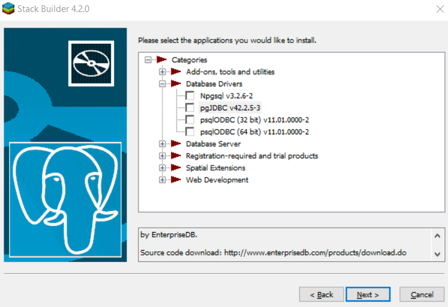
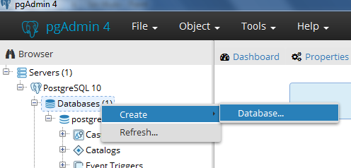

# Tema 4: BD Objeto-Relacionales y Orientadas a Objetos

*Acceso a Datos — IES Augustóbriga*

> **Apuntes revisados y actualizados**: este documento es una revisión del material original. Se han corregido erratas, eliminado prácticas obsoletas (carga manual de drivers, `Class.forName`, credenciales embebidas, falta de gestión automática de recursos), señalado con claridad que **DB4O y NeoDatis son tecnologías descontinuadas**, y añadido una sección sobre tipos `JSON`/`JSONB` como alternativa moderna dentro de PostgreSQL. Todos los ejercicios originales se mantienen íntegros.

## Índice

1. [Bases de Datos Objeto-Relacionales](#1-bases-de-datos-objeto-relacionales)
   1. [Instalación de PostgreSQL](#11-instalación-de-postgresql)
   2. [Tipos de datos](#12-tipos-de-datos)
   3. [Herencia](#13-herencia)
   4. [JDBC](#14-jdbc)
   5. [Tipos Array](#15-tipos-array)
   6. [Funciones almacenadas en el SGBD](#16-funciones-almacenadas-en-el-sgbd)
   7. [JSON / JSONB: la alternativa moderna](#17-json--jsonb-la-alternativa-moderna-nuevo)
2. [Bases de Datos Orientadas a Objetos](#2-bases-de-datos-orientadas-a-objetos)
   1. [DB4O (Database for Objects)](#21-db4o-database-for-objects)
   2. [Instalación](#22-instalación)
   3. [Acceso a la BD desde Java](#23-acceso-a-la-bd-desde-java)
   4. [Operaciones CRUD](#24-operaciones-crud)
   5. [Consultas](#25-consultas)
   6. [Relaciones entre Objetos](#26-relaciones-entre-objetos)
3. [Práctica final: Tema 5](#3-práctica-final-tema-5)
4. [Glosario](#4-glosario)

---

## 1. Bases de Datos Objeto-Relacionales

Las bases de datos objeto-relacionales (BDOR) son una extensión de las bases de datos relacionales a las que se han añadido conceptos del modelo orientado a objetos (OO), con el objetivo de simplificar el acceso a datos desde aplicaciones OO.

Un **SGBDOR** (Sistema Gestor de Bases de Datos Objeto-Relacional) es un sistema relacional que almacena objetos en tablas.

Las características del modelo objeto-relacional se definieron en el estándar **SQL:1999**:

- Soporte para tipos de datos básicos y complejos.
- Soporte para crear métodos sobre los tipos de datos complejos *(no soportado en PostgreSQL)*.
- Herencia.
- Relaciones anidadas (tablas dentro de tablas).
- Compatibilidad con el modelo relacional.

Algunos ejemplos de SGBDOR son:

- Informix
- Oracle
- PostgreSQL

### 1.1 Instalación de PostgreSQL

PostgreSQL es un SGBDOR que sigue el modelo cliente/servidor.

Se puede descargar desde [https://www.postgresql.org/download/](https://www.postgresql.org/download/). La versión instalable para Windows incluye:

- **PostgreSQL server**
- **pgAdmin**: herramienta gráfica para administrar la BD.
- **Stack Builder**: paquete que permite descargar e instalar herramientas adicionales de PostgreSQL y drivers.



> **Nota**: las capturas de este documento corresponden a PostgreSQL 10. A día de hoy conviene instalar la versión más reciente disponible (PostgreSQL 16/17), ya que las versiones antiguas dejan de recibir actualizaciones de seguridad. Los pasos de instalación y el uso de pgAdmin 4 siguen siendo los mismos.
>
> Como alternativa moderna y muy usada en entornos de desarrollo, también se puede levantar PostgreSQL con **Docker** (`docker run -e POSTGRES_PASSWORD=mipass -p 5432:5432 postgres`), sin necesidad de instalador.

Una vez instalado, se ejecuta Stack Builder para descargar e instalar el driver JDBC de PostgreSQL.

Para un proyecto Java moderno, **no es necesario descargar el `.jar` manualmente**: basta con añadir la dependencia Maven (o su equivalente en Gradle), que descargará el driver automáticamente:

```xml
<!-- https://mvnrepository.com/artifact/org.postgresql/postgresql -->
<dependency>
    <groupId>org.postgresql</groupId>
    <artifactId>postgresql</artifactId>
    <version>42.7.4</version>
</dependency>
```

> Se ha actualizado la versión del driver (`42.2.18` → `42.7.4`), que es la recomendada actualmente. Las versiones 42.2.x son de 2020 y ya no reciben parches de seguridad.

Abre pgAdmin y crea una nueva base de datos llamada **Alumnos**:



### 1.2 Tipos de datos

En PostgreSQL existen los siguientes tipos de datos:

**Tipos básicos**:

- Tipos numéricos: valores enteros, números en coma flotante y de precisión arbitraria. El tipo `serial` es un entero autoincremental.
- Tipos de fecha y hora: `date`, `time`, `timestamp`, y el tipo `interval` para representar intervalos de tiempo.
- Tipos de cadena de caracteres: prácticamente los mismos que en cualquier BD relacional.
- Tipos largos: por ejemplo, el tipo `bytea`/BLOB para representar objetos binarios.

| Tipo en Postgres | Correspondiente en SQL estándar | Descripción |
|---|---|---|
| `bool` | `boolean` | Valor lógico o booleano (`true`/`false`) |
| `char(n)` | `character(n)` | Cadena de caracteres de tamaño fijo |
| `date` | `date` | Fecha (sin hora) |
| `float4`/`float8` | `float(p)` | Número en coma flotante con precisión *p* |
| `float8` | `real`, `double precision` | Número en coma flotante de doble precisión |
| `int2` | `smallint` | Entero de dos bytes con signo |
| `int4` | `int`, `integer` | Entero de cuatro bytes con signo |
| `int4` | `decimal(p,s)` | Número exacto con precisión *p* y escala *s* |
| `int4` | `numeric(p,s)` | Número exacto con precisión *p* y escala *s* |
| `money` | `decimal(9,2)` | Cantidad monetaria |
| `time` | `time` | Hora en horas, minutos, segundos y centésimas |
| `timespan` | `interval` | Intervalo de tiempo |
| `timestamp` | `timestamp with time zone` | Fecha y hora con zona horaria |
| `varchar(n)` | `character varying(n)` | Cadena de caracteres de tamaño variable |

**Tipos compuestos (o estructurados)**: un conjunto de valores definidos por el usuario con estructura de fila de tabla, que puede estar formado por tipos de datos distintos.

**Tipos array**: un conjunto de valores distribuidos en un vector multidimensional, con la condición de que todos sean del mismo tipo de dato (básico o compuesto). Permiten crear tablas anidadas.

Declaración:

```sql
columna tipo[]      -- array unidimensional
columna tipo[][]    -- array bidimensional
```

### 1.3 Herencia

PostgreSQL permite definir tablas que heredan de otras tablas. Las tablas derivadas heredan todos los atributos de la tabla padre, pero **la herencia no es completa**: no se heredan las claves primarias ni las claves externas.

**Ejercicio 2**: Realiza las siguientes actividades en pgAdmin sobre la BD Alumnos.

- Sobre la BD Alumnos, abre una pestaña Query Tool para escribir las sentencias SQL de las tareas siguientes.
- Crea el tipo de datos `direccion` con los siguientes campos: tipo de vía, nombre de vía, número y CP.
- Crea la tabla `personas` con los campos: código (autonumérico), nombre y dirección.
- Crea las tablas `alumnos` y `profesores` que heredan de `personas`. `alumnos` tendrá además el campo `fechaM` (fecha de matrícula) y `profesores` el campo `especialidad`.
- Inserta un par de alumnos en la tabla `alumnos` y un par de profesores en la tabla `profesores`.
- Crea la tabla `asignaturas` con los campos `nombreC` (clave primaria) y `nombreL`. Inserta tres asignaturas.

Solución de referencia (transcrita de las capturas del material original):

```sql
-- Crear tipo de datos dirección
create type direccion as(
    tipoV varchar(10),
    nombreV varchar(50),
    numero int,
    cp int
);

-- Crear tabla personas
create table personas(
    codigo serial primary key,
    nombre varchar(50),
    direccion direccion
);

-- Crear tabla alumnos, hereda de personas
create table alumnos(
    fechaM date,
    primary key(codigo)
)inherits (personas);

-- Crear tabla profesores, hereda de personas
create table profesores(
    especialidad varchar(20),
    primary key(codigo)
)inherits (personas);

-- Insertar dos alumnos
insert into alumnos values
    (default,'Pepe',('C/','Antonio Concha',8,10300),'2000-02-25'),
    (default,'Luisa',('Avda','de Cáceres',18,10300),'1989-06-12');

-- Insertar dos profesores
insert into profesores values
    (default,'Jorge',('C/','Extremadura',10,10300),'Bases de datos'),
    (default,'Maria',('Avda','Ronda Sur',1,10300),'Programación');
```

### 1.4 JDBC

El acceso desde Java a PostgreSQL se realiza a través de JDBC, usando el driver añadido vía Maven en el apartado 1.1.

Desde JDBC 4.0, **no es necesario cargar el driver manualmente con `Class.forName(...)`**: el driver se registra automáticamente (mediante `ServiceLoader`) siempre que esté en el classpath. Basta con abrir la conexión directamente:

```java
try (Connection conexion = DriverManager.getConnection(
        "jdbc:postgresql://localhost:5432/Alumnos",
        usuario, contrasenya)) {

    // ... trabajar con la conexión ...

} catch (SQLException e) {
    e.printStackTrace();
}
```

> **Importante**: no escribas el usuario y la contraseña directamente en el código fuente (como `"postgres"` / `"root"` en el material original). En un proyecto real deben venir de un fichero de configuración externo o de variables de entorno, para no exponer credenciales en el repositorio. Además, usa siempre `try-with-resources` para que la conexión se cierre automáticamente aunque se produzca una excepción.

El resto del manejo de `Statement`/`PreparedStatement`/`ResultSet` es el mismo que se estudió en el Tema 2. Lo específico de PostgreSQL es cómo se recuperan, insertan y modifican los **tipos de datos compuestos**:

```java
// Recuperar los campos de un tipo compuesto
ResultSet res = sentencia.executeQuery(
    "select codigo, nombre, (direccion).tipov, (direccion).nombrev, " +
    "(direccion).numero, (direccion).cp from personas order by codigo");

// Insertar un tipo compuesto
PreparedStatement sentencia = conexion.prepareStatement(
    "insert into alumnos values(default,?,(?,?,?,?),?)");

// Modificar un tipo compuesto
PreparedStatement sentencia = conexion.prepareStatement(
    "update alumnos set direccion = (?,?,?,?) where codigo = ?");
```

**Ejercicio 3**:

- Realiza un proyecto Java en el que haya una clase para cada tabla de la BD, otra para el tipo de datos compuesto y otra para realizar el acceso a los datos. Crea métodos para mostrar los objetos.
- Realiza en el paquete por defecto un programa que permita: mostrar alumnos, mostrar profesores, insertar alumno, mostrar personas, modificar la dirección de un alumno y borrar un alumno.

### 1.5 Tipos Array

PostgreSQL permite utilizar estructuras de array como campos de tablas, incluyendo arrays multidimensionales.

Para acceder desde Java a este tipo de datos se utiliza el tipo `java.sql.Array`. Ejemplo para recuperar un array bidimensional de un `ResultSet` llamado `resultado`:

```java
Array resul = resultado.getArray(posicion);
String[][] fila = (String[][]) resul.getArray();
```

Insertar y actualizar un campo de este tipo:

```java
// Insertar una nota (array bidimensional)
PreparedStatement sentencia = conexion.prepareStatement(
    "insert into notas values (?,?,array[array[?,?]])");

// Añadir una nota al array de notas
PreparedStatement sentencia = conexion.prepareStatement(
    "update notas set notas = array_cat(notas, array[?,?]::text[][]) " +
    "where alumno = ? and asig = ?");
```

**Ejercicio 4**: Desde pgAdmin, crea la tabla `notas` (alumno, asignatura, notas) con las claves externas correspondientes a alumno y asignatura. El campo notas será un array bidimensional de `String`, donde cada fila del array almacena la fecha del examen y la nota. Inserta dos notas en dos alumnos distintos.

```sql
-- Creamos la tabla notas
create table notas(
    alumno int,
    asig varchar(10),
    notas text[][],
    primary key(alumno, asig),
    foreign key (alumno) references alumnos(codigo),
    foreign key (asig) references asignaturas(nombreC)
);

-- Insertamos datos en notas
insert into notas values
    (1,'BD',array[array['2017-01-01','8'],array['2017-02-01','9']]),
    (2,'BD',array[array['2017-01-01','5'],array['2017-02-01','6']]);
```

> **Corrección**: en el material original, la clave externa de `asig` referenciaba una tabla llamada `asig`, que no existe (la tabla se llama `asignaturas`, con clave primaria `nombreC`, según el propio enunciado del Ejercicio 2). Se ha corregido a `references asignaturas(nombreC)`.

**Ejercicio 5**: Crea las clases necesarias para trabajar con la tabla `notas`. Realiza un programa que permita:

- Mostrar las notas de todos los alumnos.
- Mostrar las notas de un alumno.
- Poner nota a un alumno en un examen. Hay que controlar si ya hay alguna nota para el alumno en esa asignatura: si existe, hay que hacer un `update`; si no, un `insert`.

### 1.6 Funciones almacenadas en el SGBD

Existen 4 tipos de funciones en el gestor de BD:

- Escritas en SQL.
- Escritas en PL/pgSQL.
- Funciones internas del sistema.
- Funciones escritas en C.

Sintaxis para crear una función en SQL:

```sql
CREATE FUNCTION nombreF(tipo_param1, tipo_param2)
RETURNS tipo
AS $$
    sentenciasSQL; ...;
$$ LANGUAGE SQL;
```

Los parámetros pueden ser de cualquier tipo admitido por el gestor (básico, compuesto, array o combinaciones). El tipo devuelto puede ser básico, array o compuesto.

Para referenciar un parámetro se usa `$pos`, donde *pos* es la posición del parámetro en la definición de la función, empezando en 1.

Se devuelve el resultado de la última consulta de la función. La forma de llamarla desde Java es la misma vista en el Tema 2.

### 1.7 JSON / JSONB: la alternativa moderna *(Nuevo)*

Además de los tipos compuestos y array vistos anteriormente, PostgreSQL ofrece desde hace años los tipos `json` y, sobre todo, **`jsonb`** (JSON en formato binario, indexable), que hoy en día son la forma más habitual de almacenar datos semiestructurados dentro de una BD relacional/objeto-relacional, especialmente cuando la estructura puede variar entre registros.

```sql
create table producto (
    id serial primary key,
    nombre varchar(100),
    atributos jsonb
);

insert into producto (nombre, atributos) values
    ('Portátil', '{"marca": "Dell", "ram_gb": 16, "garantia_meses": 24}');

-- Consultar un campo del JSON
select nombre, atributos->>'marca' as marca
from producto
where (atributos->>'ram_gb')::int >= 16;

-- Comprobar si el JSON contiene una estructura
select * from producto where atributos @> '{"marca": "Dell"}';

-- Indexar el campo jsonb para acelerar las consultas
create index idx_producto_atributos on producto using gin (atributos);
```

Frente a los tipos compuestos vistos en 1.2 (con estructura fija definida mediante `CREATE TYPE`), `jsonb` permite estructuras flexibles, es ideal para datos que varían de un registro a otro, y se puede indexar eficientemente con índices `GIN`. Es la vía recomendada hoy en día cuando se necesita ese tipo de flexibilidad dentro de PostgreSQL, en lugar de modelar tipos compuestos nuevos para cada caso.

---

## 2. Bases de Datos Orientadas a Objetos

Las BDOO soportan el paradigma orientado a objetos almacenando métodos y datos. Los datos se almacenan como objetos. Cada objeto posee un identificador único, el **OID**, que no es modificable por el usuario.

Cada objeto define atributos, métodos y la interfaz de acceso a él.

**ODMG** (Object Database Management Group) es un estándar de SGBDOO creado por un grupo de fabricantes de BD que propone:

- Un modelo de objetos.
- Un lenguaje de definición de objetos: ODL.
- Un lenguaje de consulta de objetos: OQL.
- Conexión con lenguajes de programación como C++ o Java.

> **Nota de actualización**: el estándar ODMG dejó de evolucionar hace más de 20 años y, en la práctica, el hueco que pretendía cubrir (persistencia de objetos sin desfase objeto-relacional) lo ocupan hoy herramientas muy distintas: por un lado el **mapeo objeto-relacional con JPA/Hibernate** (Tema 3), y por otro las **bases de datos de documentos** como MongoDB (Tema 3), ambas con soporte y comunidad activos.

Ejemplos de SGBDOO citados históricamente:

- DB4O
- NeoDatis

> ⚠️ **Importante**: tanto **DB4O** como **NeoDatis** son proyectos **descontinuados** (DB4O dejó de mantenerse en 2014, tras ser adquirido por Versant/Actian; NeoDatis no tiene versiones desde alrededor de 2010). No tienen soporte, no reciben parches de seguridad y su compatibilidad con versiones recientes del JDK no está garantizada. El apartado siguiente se mantiene por su **valor didáctico**, para entender cómo funciona una BD orientada a objetos "pura" (sin desfase objeto-relacional, con OID y consultas sobre objetos en lugar de SQL), pero **no se recomienda su uso en proyectos reales**. Como alternativa activa y mantenida que resuelve una necesidad similar (persistencia embebida de objetos en Java/Kotlin), se puede consultar **ObjectBox**.

### 2.1 DB4O (Database for Objects)

Es un motor de BD orientado a objetos para Java y .NET. No existe desfase objeto-relacional, ya que almacena objetos directamente.

No utiliza SQL: en su lugar se trabaja con métodos sobre el propio objeto.

La BD se almacena en un único fichero con extensión `.yap`.

### 2.2 Instalación

Pasos de instalación de DB4O (contenido histórico; el enlace de descarga original, alojado en Dropbox, puede no estar ya disponible):

1. Descargar la librería `db4o-8.0.276.16149-java.zip` (históricamente distribuida fuera de un repositorio oficial de paquetes, lo cual es en sí mismo otro indicio de que el proyecto está abandonado).
2. Descomprimir la librería.

Instalación del visor de BD, **Object Manager Enterprise (OME)**, como plugin de Eclipse:

1. Descomprimir la carpeta `db4o/ome/ObjectManagerEnterprise-Java-8.0.0.zip`.
2. Desde Eclipse: *Help → Install New Software → Add → Local →* (carpeta anterior).
3. Para abrir el visor en Eclipse: *Window → Perspective → Open Perspective → Other → OME*.

### 2.3 Acceso a la BD desde Java

- Añadir la librería `db4o-8.0.276.16149-all-java5.jar` al proyecto.
- El paquete usado es `com.db4o`.
- Crear un objeto `ObjectContainer`; si la BD no existe, se crea automáticamente:

```java
ObjectContainer bd = Db4oEmbedded.openFile("Supermercado.yap");
```

- Para cerrar la BD se usa el método `close()` de `ObjectContainer`.

### 2.4 Operaciones CRUD

Para realizar operaciones CRUD se utilizan los siguientes métodos:

**Consulta — todos los registros de una clase:**

```java
Clase o = new Clase();
ObjectSet<Clase> res = conexion.queryByExample(o);
```

**Consulta — por el valor concreto de uno o varios atributos:**

```java
Clase o = new Clase(param1, param2, ...);
ObjectSet<Clase> res = conexion.queryByExample(o);
```

**Inserción:**

```java
conexion.store(objeto);
conexion.commit();
```

**Modificación:** se recupera el objeto mediante una consulta, se modifica, y:

```java
conexion.store(objeto);
conexion.commit();
```

**Borrado:** se recupera el objeto mediante una consulta, y:

```java
bd.delete(objeto);
conexion.commit();
```

**Ejercicio 6**: Crea un nuevo proyecto llamado `Unidad5_bd4o`. Crea la clase `Producto` con constructor sin parámetros y otro solo con el código. Atributos: código (`p001`, `p002`, `a001`...), nombre, tipo (lácteo, perfumería, panadería...), precio y stock.

Crea una clase `Modelo` para manejar la BD.

Realiza un programa `Ejercicio6` que cree la BD DB4O llamada `supermercado` (si no existe) y permita insertar productos (tantos como quiera el usuario), comprobando antes de insertar que no exista ya un producto con el mismo código.

Abre OME y visualiza los productos creados: conéctate a la BD, busca las clases que hay y usa el botón derecho → *View All Objects*.

### 2.5 Consultas

Existen tres tipos de consultas en DB4O:

- **QBE**: Query By Example.
- **NQ**: Native Queries.
- **SODA**: Soda Query API (API de más bajo nivel, no se desarrolla en este tema).

#### QBE (Query By Example)

Se crea un prototipo del objeto que se desea recuperar. DB4O recupera todos los objetos que contengan el mismo valor en los atributos no nulos del prototipo.

Si el objeto prototipo está vacío, se recuperan todos los objetos de esa clase.

No se pueden utilizar operadores como `AND`, `OR` o `NOT`.

El resultado se devuelve en un objeto `ObjectSet`, que se recorre así:

```java
while (resultado.hasNext()) {
    Clase objeto = (Clase) resultado.next();
}
```

El número de registros seleccionados está en `resultado.size()`.

**Ejercicio 7**: Realiza un programa que muestre los productos de un tipo que se pide por parámetro. Si el usuario introduce `*` como tipo de producto, se mostrarán todos los productos.

**Ejercicio 8**: Realiza un programa que muestre todos los productos y permita modificar el stock o borrar un producto cuyo código se pide por parámetro.

#### Queries Nativas

Es el tipo de consulta más usado, ya que permite establecer condiciones con más tipos de operadores.

Para establecer una o varias condiciones hay que redefinir el método `match` de la clase `Predicate`. Se seleccionan los objetos que pasen el chequeo del método (devuelvan `true`).

Ejemplo: obtener los productos cuyo precio es mayor de 10 €:

```java
ObjectSet<Producto> res = conexion.query(new Predicate<Producto>() {
    public boolean match(Producto p) {
        return p.getPrecio() > 10;
    }
});

while (res.hasNext()) {
    Producto p = res.next();
    p.mostrar();
}
```

> **Nota**: esta API con clases anónimas es anterior a las lambdas de Java 8; es parte de por qué resulta hoy "antigua" en estilo, además de en mantenimiento.

**Ejercicio 9**: Realiza un programa que permita mostrar los productos según los siguientes criterios:

- Que el stock esté dentro de un rango que se pide por parámetro.
- Que el nombre o el precio coincidan con lo que se pide por parámetro.
- Que el nombre contenga los caracteres de una cadena que se pide por parámetro.

### 2.6 Relaciones entre Objetos

DB4O permite crear relaciones entre objetos cuando un atributo de una clase es un objeto de otra clase, o cuando un atributo de una clase es un array/lista de objetos de otra clase. Se realiza con el tipo `java.util.List`.

Cuando existen relaciones, es posible elegir qué ocurre con las modificaciones o borrados del objeto padre. Si se activa el comportamiento en **cascada**, los cambios se propagan también a los objetos hijos — **esto es peligroso**, ya que puede borrar en cadena todos los objetos referenciados sin previo aviso. La configuración se realiza al abrir la conexión:

```java
public Modelo() {
    try {
        EmbeddedConfiguration config = Db4oEmbedded.newConfiguration();
        config.common().objectClass(Producto.class).cascadeOnUpdate(true);
        config.common().objectClass(Producto.class).cascadeOnDelete(false);
        conexion = Db4oEmbedded.openFile(config, "supermercado.yap");
    } catch (Exception e) {
        e.printStackTrace();
        System.out.println("Error al conectar con la BD");
    }
}
```

> **Corrección**: el ejemplo original de este apartado (recuperado de una captura del documento) usaba `Habitacion.class` y el fichero `"hotel.yap"`, de un dominio distinto al resto del tema (hotel, en vez de producto/cliente/compra). Se ha sustituido por un ejemplo coherente con el dominio `Producto`/`Cliente`/`Compra` usado en el resto del tema. Se recomienda activar `cascadeOnDelete` solo cuando se tenga total seguridad de que es el comportamiento deseado, dado el riesgo de borrados en cadena no intencionados.

**Ejercicio 10**: Crea la clase `Cliente` (constructor con el NIF):

- `nif`: no puede repetirse — comprobar antes de insertar.
- `nombre`.

Crea la clase `Compra` (constructor con el código):

- `codigo`: entero que debe funcionar como autonumérico (ver más abajo cómo).
- `fecha`.
- `cliente`.

Crea una clase `CodigoCompra` que permita generar el código de la compra de forma autonumérica: la idea es que haya un objeto que guarde el último valor de código de compra usado.

Realiza un programa que permita:

- Crear un cliente.
- Crear una compra con la fecha del día para un cliente existente.
- Ver las compras realizadas.
- Ver las compras de un cliente cuyo NIF se pasa por parámetro.
- Cambiar el NIF de un cliente, con o sin compras.
- Borrar una compra.

**Ejercicio 11**: Crea la clase `Linea`, que representa las líneas de una compra (constructor con todos los atributos):

- `compra`.
- `producto`.
- `cantidad`.
- `importe` (cantidad × precio del producto).

Modifica la clase `Compra` para que tenga un atributo con las líneas de cada compra.

Realiza un programa en Java que permita:

- Crear una compra con tantos productos como desee el usuario.
- Mostrar compras (incluyendo sus líneas).
- Modificar una compra para añadir una línea.
- Modificar una compra para borrar una línea (pidiendo el código de compra y el código de producto; se borrarán todas las líneas con ese producto).
- Borrar una compra, borrando también sus líneas.

---

## 3. Práctica final: Tema 5

> Se ha corregido el título original del apartado, que decía erróneamente "PRÁCTICA FINAL TEMA4".

Se desea poner en funcionamiento una herramienta de comunicación para los empleados de una empresa, que permita enviar mensajes a un grupo de empleados que pertenecen a un departamento. Se encarga realizar la base de datos de esta aplicación.

**De cada empleado se almacena:**

- Nº de empleado (autonumérico). No puede haber dos empleados con el mismo número de empleado.
- Apellidos.
- Nombre.
- Datos de nómina.
- Fecha de contratación.
- % de retención de IRPF.

**De cada grupo se almacena:**

- Nombre del grupo: no puede haber dos grupos con el mismo nombre.
- Lista de números de empleado de ese grupo.

**De cada mensaje se almacena:**

- Id (autonumérico, no se puede repetir).
- Empleado remitente.
- Grupo destinatario.
- Texto del mensaje.

**Tareas:**

1. Realiza en pgAdmin la base de datos descrita anteriormente.
2. Crea un programa que permita:
   - Crear empleados.
   - Mostrar empleados.
   - Crear grupo (inicialmente con la lista de empleados vacía).
   - Añadir empleados al grupo.
   - Mostrar grupo (información del grupo y de sus empleados).
   - Crear mensaje.
   - Mostrar todos los mensajes enviados.
   - Mostrar los mensajes de un empleado que se pasa por parámetro, tanto los recibidos como los enviados.
   - Mostrar el número de mensajes enviados por cada empleado.
   - Borrar un grupo (se borrarán también los mensajes enviados a ese grupo).
3. Realiza un programa que permita crear en DB4O una base de datos importando los datos de la BD de Postgres.
4. Crea un programa que, utilizando la BD DB4O, permita realizar las mismas acciones descritas en el punto 2 de esta práctica.

---

## 4. Glosario

| Término | Significado |
|---|---|
| SGBDOR | Sistema Gestor de BD Objeto-Relacional |
| SGBDOO | Sistema Gestor de BD Orientada a Objetos |
| OID | Object IDentifier: identificador único e inmutable de un objeto en una BDOO |
| ODMG | Object Database Management Group: estándar (hoy obsoleto) para SGBDOO |
| ODL | Object Definition Language, del estándar ODMG |
| OQL | Object Query Language, del estándar ODMG |
| QBE | Query By Example: consulta mediante un objeto-prototipo |
| `jsonb` | Tipo de dato de PostgreSQL para almacenar JSON en formato binario indexable |
| Tipo compuesto | Tipo de dato definido por el usuario, con estructura de fila (PostgreSQL) |
| Herencia de tablas | Mecanismo de PostgreSQL por el que una tabla hereda las columnas de otra (no las claves) |

---

*IES Augustóbriga — Acceso a Datos*
