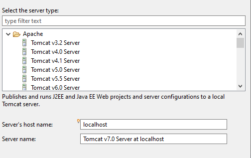
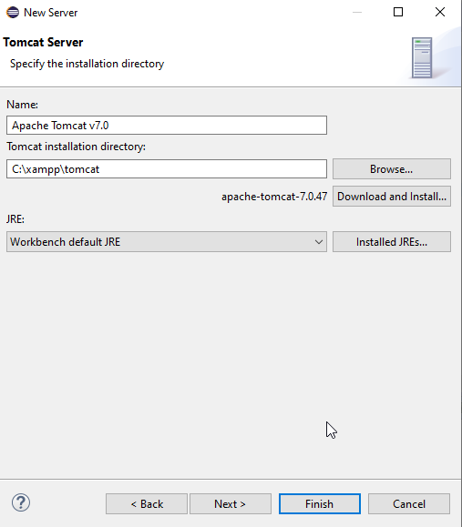

# Tema 6: Creación de Componentes de Acceso a Datos

*Acceso a Datos — IES Augustóbriga*

> **Nota de actualización**: se ha actualizado la terminología Java EE → **Jakarta EE** (y el paquete `javax.*` → `jakarta.*` según la versión de Tomcat), se han puesto al día las versiones de JDK y Tomcat citadas, se ha simplificado la instalación de las herramientas de Eclipse, y se ha añadido una nota sobre las alternativas actuales a JSP y sobre la diferencia entre el JavaBean clásico y los *beans* de Spring. Todos los ejercicios originales se mantienen íntegros.

## Índice

1. [¿Qué es un componente?](#1-qué-es-un-componente)
2. [Tecnologías de desarrollo de componentes](#2-tecnologías-de-desarrollo-de-componentes)
3. [JavaBeans](#3-javabeans)
   1. [Características](#31-características)
   2. [Reglas](#32-reglas)
   3. [Propiedades](#33-propiedades)
   4. [Eventos](#34-eventos)
4. [Empaquetado de componentes](#4-empaquetado-de-componentes)
5. [Desarrollo con Jakarta EE](#5-desarrollo-con-jakarta-ee-antes-java-ee)
6. [Glosario](#6-glosario)

---

## 1. ¿Qué es un componente?

**Definición (Szyperski, 1998)**: "Un componente es una unidad de composición de aplicaciones software, que posee un conjunto de interfaces y un conjunto de requisitos, y que ha de poder ser desarrollado, adquirido, incorporado al sistema y compuesto con otros componentes de forma independiente, en tiempo y espacio".

El objetivo del desarrollo de componentes es construir aplicaciones mediante el ensamblado de módulos software reutilizables, diseñados previamente con independencia de las aplicaciones en las que van a ser utilizados.

Las características de un componente son:

- **Aislamiento**: un componente puede instalarse de forma independiente en una plataforma.
- **Componibilidad**: un componente puede estar compuesto por otros para formar aplicaciones.
- **Opacidad**: un componente se maneja siempre de forma opaca, sin que los diseñadores de las aplicaciones que lo usan, ni el entorno, tengan que acceder a sus detalles internos para hacer uso de él.

Las principales ventajas del desarrollo basado en componentes son:

- Mejora de la productividad, gracias a la reutilización de software.
- Disminución de la complejidad del software.
- Mejora de los tiempos de acceso al mercado.
- Incremento de la calidad del software.
- Mejora del mantenimiento, al ser más fácil detectar y subsanar errores.

## 2. Tecnologías de desarrollo de componentes

Las tecnologías de desarrollo de componentes incluyen:

- **Modelo de componentes**: define un marco conceptual para el desarrollo de componentes y de aplicaciones generadas por ensamblado; define con exactitud qué se entiende por componente, cómo se especifica el componente y sus interfaces, y los modos de interacción entre componentes.
- **Plataforma de componentes**: entorno de soporte para la ejecución de aplicaciones basadas en componentes. Se apoya en un modelo de componentes concreto e incluye servicios de soporte: gestión del ciclo de vida, persistencia, comunicación entre componentes, etc.

Inicialmente se diseñaron para ser utilizados y manipulados por herramientas visuales. En este tema se tratan orientados al acceso a datos, usando el mismo componente para acceder a una BD desde distintas aplicaciones.

Ejemplos de tecnologías de componentes:

- **Microsoft**: COM, COM+, .NET (plataforma Windows).
- **Sun Microsystems / Oracle**: JavaBeans, EJB (multiplataforma, pero solo en Java).

> **Nota de actualización**: EJB (Enterprise JavaBeans), en su forma clásica y pesada (EJB 1.x/2.x), es hoy una tecnología que se encuentra en muy pocos proyectos nuevos; aunque EJB 3.x la simplificó notablemente, en la práctica actual la inmensa mayoría de aplicaciones empresariales Java usan **Spring / Spring Boot** en su lugar, por ser más ligero y flexible. Se mantiene la referencia a EJB por completitud histórica y porque sigue usándose en sistemas heredados.

## 3. JavaBeans

Un JavaBean es un componente de software reutilizable, escrito en Java. Ejemplos de JavaBeans:

- Librerías gráficas AWT.
- Librería SWT de Eclipse.

> **Nota de actualización**: este modelo clásico de JavaBeans (con introspección, propiedades ligadas y restringidas mediante `PropertyChangeSupport`) nació pensado para **herramientas visuales de construcción de interfaces gráficas de escritorio** (por ejemplo, el antiguo editor visual de NetBeans). Hoy en día sigue siendo una API válida y presente en el JDK, pero su uso real está prácticamente limitado a ese contexto histórico de GUI de escritorio. **No debe confundirse con los *beans* de Spring**: en el ecosistema Spring, un "bean" es simplemente un objeto gestionado por el contenedor de inyección de dependencias (con anotaciones como `@Component`, `@Service`, `@Repository`), un concepto relacionado en el nombre pero mucho más simple, que no exige implementar el mecanismo de eventos `PropertyChangeSupport`/`PropertyChangeListener` descrito en este apartado. En el desarrollo backend/de acceso a datos actual, cuando se habla de "beans" normalmente se refiere a este segundo significado.

### 3.1 Características

- **Introspección**: deben proporcionar información sobre sus características (propiedades, métodos y eventos).
- **Personalización**: el programador puede alterar la apariencia y la conducta del bean.
- **Manejo de eventos**: debe poder comunicarse con otros beans utilizando eventos.
- **Propiedades**: permiten cambiar los valores del bean para personalizarlo (*customization*).
- **Persistencia**: se puede guardar el estado de un bean personalizado, cambiando los valores de sus propiedades, para restaurarlo en cualquier momento.

### 3.2 Reglas

- Debe tener al menos un constructor sin argumentos.
- Debe tener persistencia, es decir, implementar la interfaz `Serializable`.
- Las propiedades deben ser accesibles mediante métodos `get` y `set`.
- Los nombres de los métodos deben seguir ciertas reglas de nombrado, para conseguir la introspección.

### 3.3 Propiedades

Son los atributos que determinan el estado del bean. Se accede a ellas mediante getters y setters. Hay varios tipos:

- **Simples**: representan un único valor.
  - `private int edad` / `public int getEdad()` / `public void setEdad(int valor)`
  - `private boolean hombre` / `public boolean isHombre()` / `public void setHombre(boolean valor)`
- **Indexadas**: representan un array de valores al que se accede mediante un índice. Deben tener getter/setter para el array completo y para valores individuales del array.
- **Ligadas o compartidas**: asociadas a eventos. Cuando la propiedad cambia, se notifica a todos los objetos interesados, permitiéndoles reaccionar. El componente necesita una lista de receptores de la propiedad para avisarles del cambio; se añaden con los métodos de la interfaz `PropertyChangeSupport`. Para que un bean receptor pueda actuar cuando se modifica la propiedad, debe implementar la interfaz `PropertyChangeListener`.
- **Restringidas**: similares a las ligadas, pero los objetos receptores del evento pueden vetarlo si no se ajusta a determinadas características.

### 3.4 Eventos

Permiten la comunicación entre beans: un bean lanza el evento y otro(s) lo escuchan y responden.

El bean que lanza el evento debe declarar una propiedad ligada, de tipo `PropertyChangeSupport`, e implementar dos métodos: uno para añadir receptores del evento y otro para eliminarlos.

- `addReceptor(PropertyChangeListener listener)`: llama al método `addPropertyChangeListener(listener)` de la propiedad ligada.
- `borrarReceptor(PropertyChangeListener listener)`: llama al método `removePropertyChangeListener(listener)` de la propiedad ligada.

El evento se lanza en el momento adecuado con el método `firePropertyChange()`, al que se le pasan tres parámetros:

- Nombre de la propiedad: `String`.
- Valor antiguo: `Object` (para tipos básicos hay que usar `Integer`, `Float`, etc.).
- Valor nuevo: `Object`.

La aplicación añade objetos receptores del evento con `addReceptor(objetoReceptor)`.

Los beans receptores del evento deben implementar `PropertyChangeListener` y sobrescribir el método `propertyChange()` para definir qué acciones realizar cuando se produzca el evento.

## 4. Empaquetado de componentes

Una vez desarrollado el JavaBean, debe empaquetarse para su distribución y utilización por las aplicaciones.

La forma habitual es crear un `.jar` (*File → Export*), que debe contener un fichero `MANIFEST.MF` que describa el contenido, además de las clases y recursos que lo forman.

**Ejercicio 1**: Ejecuta en MySQL el script `tienda.sql`.

- Crea un proyecto llamado `tienda` y configura el acceso a la BD con Hibernate.
- Implementa un método `mostrar` en cada clase. En `Productos` no es necesario mostrar los pedidos ni las ventas de un producto.
- Realiza las modificaciones necesarias para que, al registrar una venta de un producto, se cree automáticamente un pedido si el stock del producto es inferior al stock mínimo.
- La clase `Producto` debe generar un evento cuando, al actualizar el stock, se dé la situación de que el stock actual está por debajo del mínimo.
- Cuando se realiza una venta se debe:
  - Comprobar si hay stock.
  - Registrar la venta.
  - Añadir la venta como receptor del evento.
  - Actualizar el stock.
- Cuando se produzca el evento, la venta debe generar automáticamente un pedido. La cantidad de ese pedido será siempre de 10 unidades.
- Crea un modelo que implemente los siguientes métodos:

```java
public boolean crearPedido(Pedidos p) { }
public boolean crearProducto(Productos p) { }

/**
 * @param v Ventas
 * @return 1 si va bien, 0 si no hay stock, -1 error al crear la venta
 */
public int crearVenta(Ventas v) { }

public ArrayList<Productos> obtenerProductos() { }
public ArrayList<Pedidos> obtenerPedidos() { }
public ArrayList<Ventas> obtenerVentas() { }
public Productos obtenerProducto(int codigo) { }
```

- Crea una librería con el proyecto `tienda`.

**Ejercicio 2**: Crea un programa en Java que, utilizando el componente creado en el Ejercicio 1, permita:

- Crear productos.
- Listar productos.
- Crear pedidos.
- Listar pedidos.
- Crear ventas.
- Listar ventas.

## 5. Desarrollo con Jakarta EE *(antes "Java EE")*

> **Nota de actualización**: en 2018 Oracle transfirió la plataforma Java EE a la Eclipse Foundation, que la renombró **Jakarta EE** por motivos de marca registrada propiedad de Oracle. Desde Jakarta EE 9 (2020), todos los paquetes pasaron de `javax.*` a `jakarta.*`. Esto afecta directamente a los Servlets de este apartado: **Tomcat 9 y anteriores usan `javax.servlet.*`**, mientras que **Tomcat 10 y posteriores usan `jakarta.servlet.*`**. Al montar el entorno hay que elegir una combinación coherente de versión de Tomcat y paquete de Servlet.

Jakarta EE (Java Empresarial) es una plataforma de programación para desarrollar y ejecutar aplicaciones software en el lenguaje Java.

Como servidor de las aplicaciones vamos a usar **Apache Tomcat**: servidor de aplicaciones web y contenedor de servlets y páginas JSP.

> Se ha actualizado la recomendación de instalación: en lugar de usar el Tomcat empaquetado dentro de XAMPP (como en el material original), es más habitual hoy **descargar Tomcat directamente desde `tomcat.apache.org`** e instalarlo de forma independiente. Para la versión del servidor: Tomcat 9 (`javax.servlet`) es una opción estable y muy documentada para un entorno de aprendizaje; Tomcat 10/11 (`jakarta.servlet`) es la línea activa y recomendada para proyectos nuevos. Evita versiones antiguas como Tomcat 7 (captura original), sin soporte desde 2021.
>
> Como alternativa moderna que evita por completo la configuración manual de un servidor externo, se puede usar **Spring Boot** con su servidor Tomcat embebido (dependencia `spring-boot-starter-web`): se ejecuta la aplicación como un `.jar` autónomo, sin necesidad de desplegarla en un Tomcat instalado aparte.

### Añadir herramientas de desarrollo Jakarta EE en Eclipse

La forma más sencilla hoy es descargar directamente el paquete **"Eclipse IDE for Enterprise Java and Web Developers"** desde el Eclipse Installer, que ya incluye las herramientas necesarias preinstaladas.

Si se parte de una instalación base de Eclipse y se quiere añadir el soporte manualmente:

1. *Help → Install New Software*.
2. Seleccionar el sitio de actualización correspondiente a la versión de Eclipse instalada (el repositorio de ejemplo del material original, `2019-09`, está desactualizado).
3. Instalar **"Web, XML, Java EE and OSGi Enterprise Development"**.

### Integración de Eclipse con Tomcat

Para poder probar las aplicaciones desde Eclipse:

- Crear la variable de entorno del sistema `JAVA_HOME` apuntando al JDK instalado (se recomienda una versión LTS actual, por ejemplo JDK 17 o 21, en vez del JDK 12 —versión de ciclo corto y sin soporte desde hace años— citado en el material original).
- En Eclipse, panel *Server*: `Window → Show View → Other → Server`.
- Agregar servidor:





### Servlet

Son programas Java que se ejecutan en un servidor. Pueden generar una respuesta HTML, llamar a otros servlets, usar cookies y sesiones, y enlazar entre un cliente y una BD.

La diferencia con las páginas JSP (código Java embebido en HTML) es que el servlet es solo código Java que puede generar una respuesta HTML.

La mayoría de las tareas pueden hacerse con JSP. Los servlets se usan cuando hay que programar mucho código Java. Suelen trabajar de forma conjunta: en el patrón MVC, los servlets hacen de controlador y los JSP de vista.

Un servlet es una clase Java sin `main()` que recibe peticiones e invoca métodos:

- `init()`
- `service()`
- `destroy()`

Ciclo de vida de un servlet:

1. El cliente solicita una petición a un servidor web a través de una URL. El servidor recibe la petición.
2. Si es la primera vez, el servidor carga el servlet y llama al método `init()` para iniciarlo. No es obligatorio definirlo; suele usarse para configuraciones iniciales.
3. Se llama al método `service()` para procesar las peticiones de los clientes web. Es obligatorio definirlo.
4. Se llama al método `destroy()` para eliminar el servlet y liberar recursos. Es opcional implementarlo.

Un servlet hereda de la clase `HttpServlet`. Los métodos `doGet`/`doPost` se activan con las peticiones al servlet (`doGet(HttpServletRequest, HttpServletResponse)`); hay que sobrescribirlos, establecer el formato de la respuesta y generar su contenido (`HttpServletResponse.getWriter()`; en `doPost()` hay que especificar `response.setContentType("text/html")`).

### Paso de parámetros de un Servlet a un JSP

Interfaz `RequestDispatcher`, método `forward()`. Se puede usar con el objeto `Request`.

### Páginas JSP

Permiten generar HTML dinámico. Son páginas HTML con código Java incrustado.

- `<%= ... %>`: una línea de código, cualquier expresión Java.
- `<% código %>`: varias líneas separadas por `;`, cualquier expresión Java.
- `<%! ... %>`: varias líneas, solo declaraciones de métodos y variables.

> **Nota de actualización**: JSP sigue funcionando en Jakarta EE, pero su uso en proyectos nuevos ha decaído considerablemente. Las alternativas actuales más comunes son **Thymeleaf** (motor de plantillas del lado del servidor, integrado de forma nativa en Spring Boot) cuando se quiere renderizar HTML en el propio servidor, o directamente **separar backend y frontend**: el servidor expone una API REST y un framework de frontend (React, Angular, Vue) se encarga de la interfaz. Se mantiene JSP en este tema por su valor para entender los fundamentos de generación de HTML dinámico en Java, pero conviene saber que ya no es la opción por defecto en un proyecto nuevo.

## 6. Glosario

| Término | Significado |
|---|---|
| Componente | Unidad de composición software reutilizable, con interfaz definida y desarrollo independiente |
| JavaBean | Componente software reutilizable en Java que sigue unas reglas de introspección/persistencia |
| EJB | Enterprise JavaBeans: modelo de componentes de la vieja Java EE para lógica de negocio distribuida |
| Jakarta EE | Nombre actual de la plataforma Java EE desde su cesión a la Eclipse Foundation (2018) |
| Servlet | Clase Java que procesa peticiones HTTP en un servidor y genera una respuesta |
| JSP | JavaServer Pages: páginas HTML con código Java incrustado, para generar HTML dinámico |
| MVC | Modelo-Vista-Controlador: patrón de arquitectura, donde el servlet actúa de controlador y el JSP de vista |
| `PropertyChangeSupport`/`Listener` | Mecanismo de eventos de JavaBeans para propiedades ligadas/restringidas |

---

*IES Augustóbriga — Acceso a Datos*
